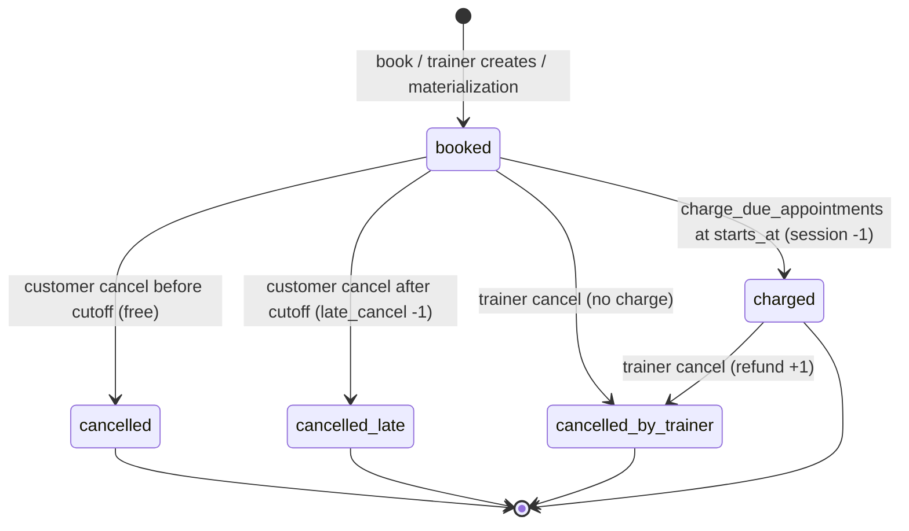

# Appointment states

Life cycle of an `appointments.status`. A new appointment is `booked`. The charge job moves it
to `charged` at start time (ADR 0002). A customer cancel before the cutoff is free
(`cancelled`); after the cutoff it is `cancelled_late` and charged at cancel time. The trainer
can cancel in any state without charge (`cancelled_by_trainer`); if a charge exists, a `refund`
transaction is inserted. A customer cannot cancel a `charged` appointment.

