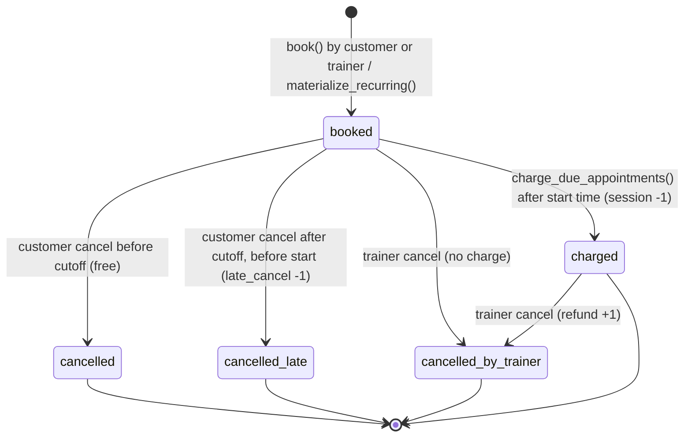

# Appointment states

Life cycle of an `appointments.status`. A new appointment is `booked` (`book()`). The charge
job `charge_due_appointments()` moves it to `charged` at start time (ADR 0002). A customer
`cancel()` before the cutoff is free (`cancelled`); after the cutoff and before the start it is
`cancelled_late` and charged at cancel time. Once the appointment has started the customer can
no longer cancel it. The trainer
can cancel from `booked` or `charged` without charge (`cancelled_by_trainer`); from `charged` a
`refund` transaction is inserted. A customer cannot cancel a `charged` appointment, and a
`cancelled_late` appointment cannot be cancelled again (the trainer waives the charge with
`adjust(+1, note)`).

