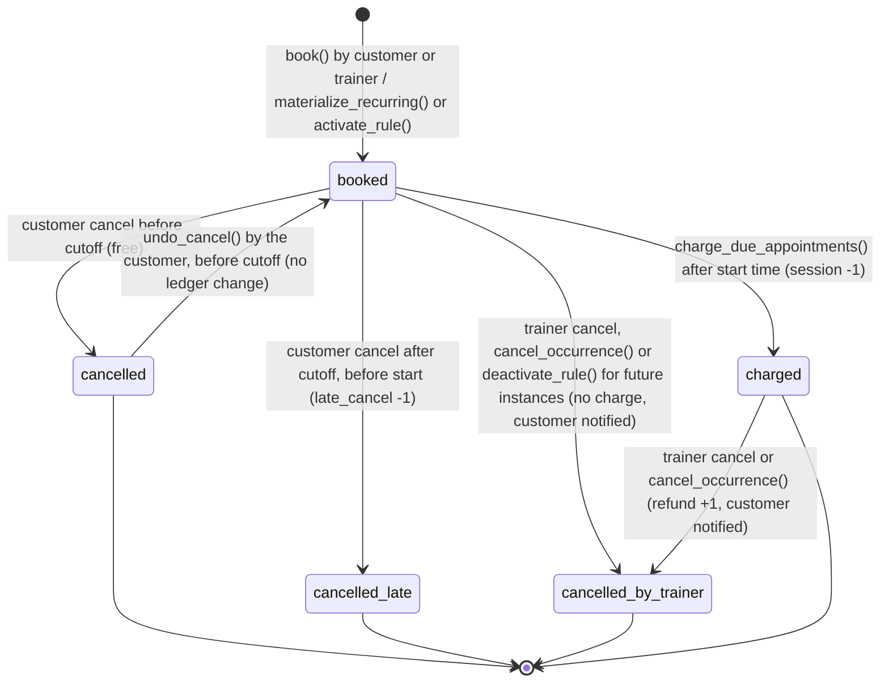

# Appointment states

Life cycle of an `appointments.status`. A new appointment is `booked` (`book()`). The charge
job `charge_due_appointments()` moves it to `charged` at start time (ADR 0002). A customer
`cancel()` before the cutoff is free (`cancelled`); after the cutoff and before the start it is
`cancelled_late` and charged at cancel time. Before the cutoff the customer can undo a free
cancel (`undo_cancel()`): the same row goes back to `booked` with no ledger change, if the
occurrence still takes it (rule active, not blocked, template active, a free place). A
`cancelled_late` or `cancelled_by_trainer` appointment cannot be restored. Once the appointment
has started the customer can no longer cancel it. The trainer
can cancel from `booked` or `charged` without charge (`cancelled_by_trainer`), with an optional
reason (`cancel_reason`); from `charged` a `refund` transaction is inserted. Every move into
`cancelled_by_trainer` notifies the customer (ADR 0015). `cancel_occurrence()` does the trainer's
cancel for every live appointment of one slot occurrence at once and closes it with a blocked
period (ADR 0016). A customer cannot cancel a `charged` appointment, and a
`cancelled_late` appointment cannot be cancelled again (the trainer waives the charge with
`adjust(+1, note)`). A new appointment can also come from `materialize_recurring()` or
`activate_rule()` (an instance of a recurring rule); deactivating the rule
(`deactivate_rule()`) moves its future `booked` instances to `cancelled_by_trainer`, and a
cancelled instance is never recreated by materialization (only the customer's undo restores it).

