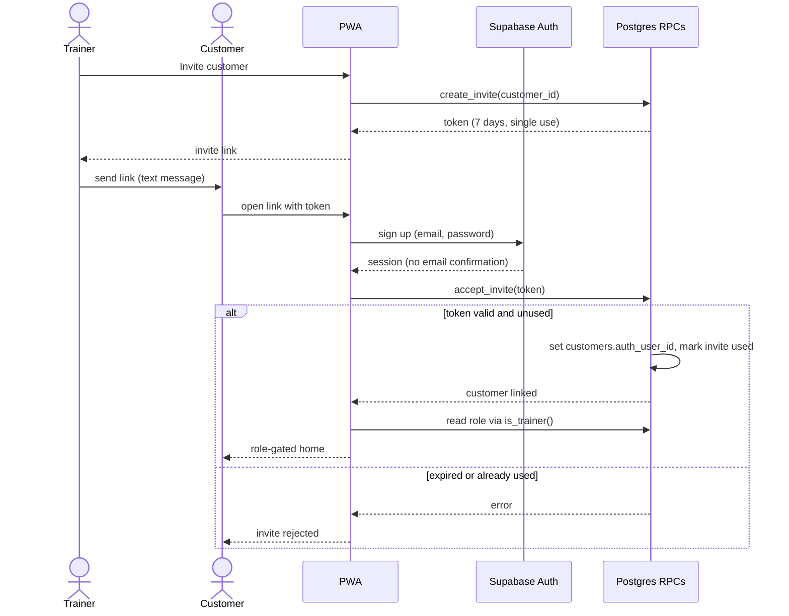

# Auth and invite flow

How a customer gets an account (ADR 0006). The trainer creates an invite for a customer record
with `create_invite`, which returns a single-use token valid for 7 days. The customer opens the
link, signs up with email and password (no confirmation email), and the app calls
`accept_invite`, which links the new auth user to the customer record. After that the app routes
by role: the trainer sees the trainer shell, a customer sees the customer home. A user with no
`customers` row has no data access.

