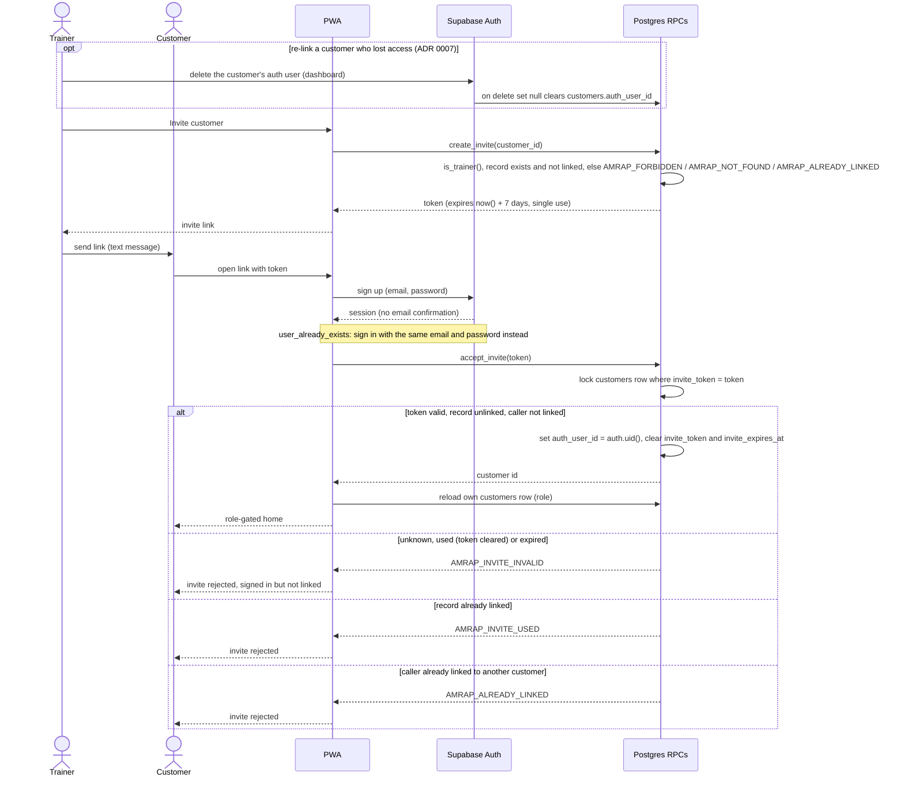

# Auth and invite flow

How a customer gets an account (ADR 0006). The trainer UI for this step arrives in Stage 2;
in Stage 1 the owner issues the token with the SQL recipe in
[runbook.md](../runbook.md#invite-a-customer-stage-1-until-the-customers-screen-exists). The trainer creates an invite for an unlinked
customer record with `create_invite(customer_id)`, which returns a single-use token (24 random
bytes, hex) valid for 7 days; re-issuing replaces the previous token. The customer opens the
link, signs up with email and password (no confirmation email), and the app calls
`accept_invite(token)`, which locks the record by token, checks it, links the new auth user
(`customers.auth_user_id`) and clears the token. The app then reloads the user's own
`customers` row (the role comes from that row) and routes by role: the trainer sees the trainer
shell, a customer sees the customer home. A user with no `customers` row has no data access and
sees an "account not linked" page with a sign-out button.

If the sign-up already succeeded earlier but `accept_invite` did not run or was rejected (a
dropped request, or an invite replaced by a newer one), the auth user exists but is unlinked.
Opening the invite link again and entering the same email and password makes the page sign in
instead (sign-up answers `user_already_exists`) and then call `accept_invite`; a wrong password
shows the "account exists" message. If `accept_invite` itself rejects the token, the page shows
the mapped error ([rpcs.md](../rpcs.md#accept_invite)) and a continue link that ends on the
not-linked page; the trainer issues a new invite (`create_invite` replaces the token).

`create_invite` refuses a record that is already linked. To re-link a customer who lost access
(ADR 0007), the trainer first deletes the customer's auth user in the Supabase dashboard; the
foreign key `on delete set null` clears `customers.auth_user_id`, and the flow below starts
again with a new sign-up (steps in [runbook.md](../runbook.md#re-link-a-customer)).

