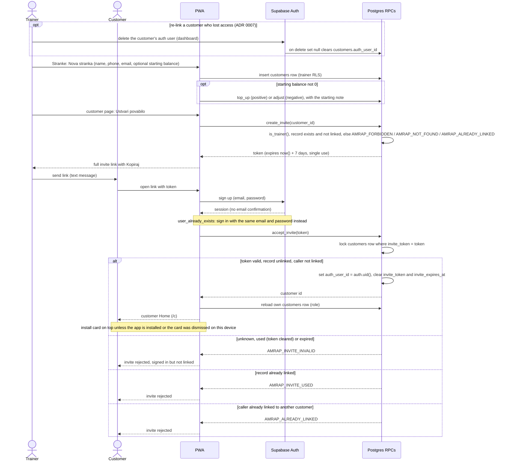
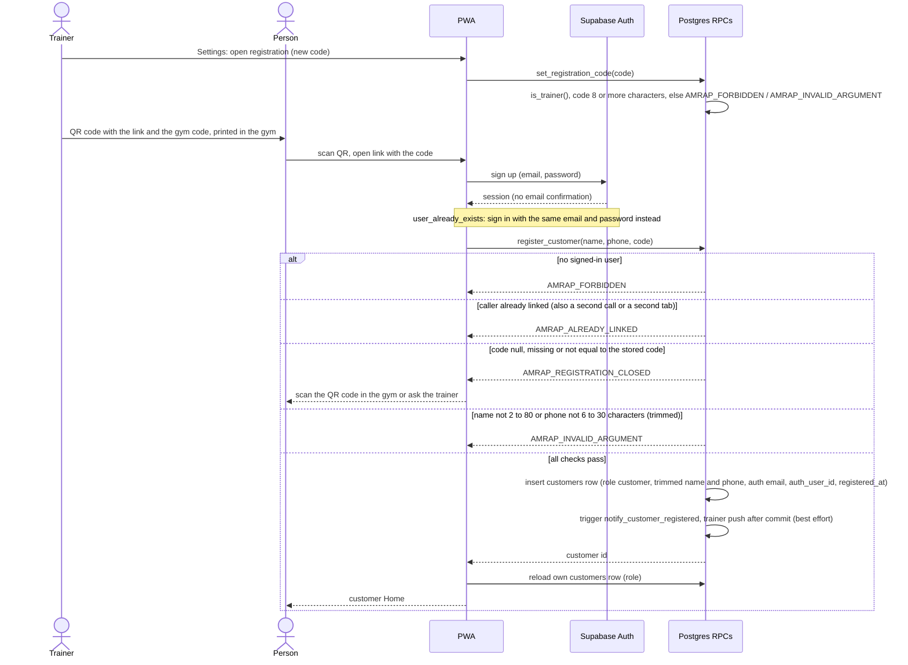

# Auth and invite flow

How a customer gets an account. There are two ways in: the trainer's invite (ADR 0006), below,
and registration with the gym code (ADR 0021), in
[Registration with the gym code](#registration-with-the-gym-code). In the invite flow, the trainer creates the customer record on the
Customers screen and, on the customer's page, taps **Ustvari povabilo** (steps in
[runbook.md](../runbook.md#invite-a-customer); an SQL fallback is there too). The app creates an invite for an unlinked
customer record with `create_invite(customer_id)`, which returns a single-use token (24 random
bytes, hex) valid for 7 days; re-issuing replaces the previous token. The customer opens the
link, signs up with email and password (no confirmation email), and the app calls
`accept_invite(token)`, which locks the record by token, checks it, links the new auth user
(`customers.auth_user_id`) and clears the token. The app then reloads the user's own
`customers` row (the role comes from that row) and routes by role: the trainer sees the trainer
shell, a customer lands on the customer Home, with the install card on top on a device where
the app is not installed ([screens.md](../screens.md#install-card), [auth.md](../auth.md)). A
user with no `customers` row has no data access and sees an "account not linked" page with a
sign-out button.

If the sign-up already succeeded earlier but `accept_invite` did not run or was rejected (a
dropped request, or an invite replaced by a newer one), the auth user exists but is unlinked.
Opening the invite link again and entering the same email and password makes the page sign in
instead (sign-up answers `user_already_exists`) and then call `accept_invite`; a wrong password
shows the "account exists" message. If `accept_invite` itself rejects the token, the page shows
the mapped error ([rpcs.md](../rpcs.md#accept_invite)) and a continue link that ends on the
not-linked page; the trainer issues a new invite (`create_invite` replaces the token).

`create_invite` refuses a record that is already linked. To re-link a customer who lost access
(ADR 0007), the trainer first deletes the customer's auth user in the Supabase dashboard; the
foreign key `on delete set null` clears `customers.auth_user_id`, and the flow below starts
again with a new sign-up (steps in [runbook.md](../runbook.md#re-link-a-customer)).

## Registration with the gym code

A person scans the QR code in the gym. The link holds the gym code
(`/registracija?koda=<gym code>`). The person signs up with email and password (no
confirmation email), and the app calls `register_customer(name, phone, code)`
([rpcs.md](../rpcs.md#register_customer)). The function checks, in this order: a signed-in
user, the caller not linked yet, the gym code, then name and phone. It then creates the
customer record linked to the caller. Registration only ever creates the role `customer`. A
trigger then sends the trainer a push (`customer_registered`, best effort,
[notifications.md](../notifications.md#event-notifications)).

"Closed" and "wrong code" give the same error, `AMRAP_REGISTRATION_CLOSED`, so the answer never
confirms a code. The trainer sets or clears the code with `set_registration_code(code)`; a new
code makes every old QR code fail. If the sign-up worked but `register_customer` did not run or
was refused, the auth user exists but has no record, as in the invite flow.

A person who already had a record and registers anyway gets a second record. The trainer
deletes the new one with `delete_customer` ([rpcs.md](../rpcs.md#delete_customer)), which only
accepts a record with no history, deletes its auth user in the dashboard, and invites the
person to the old record (runbook "A customer registered twice").

