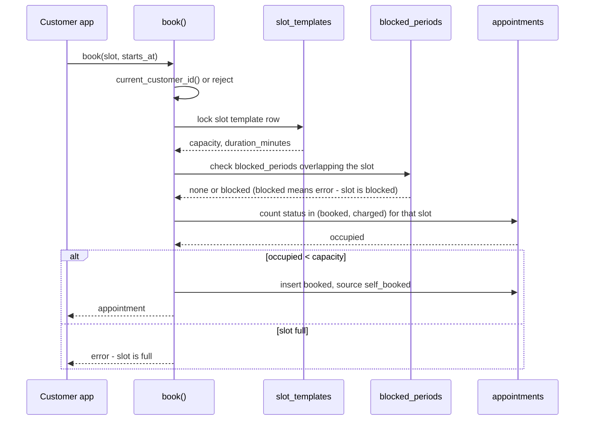

# Booking sequence

How a customer books an open slot. `book()` is a `SECURITY DEFINER` RPC that runs in one
transaction: it checks the caller is a customer, locks the slot so concurrent bookings are
serialized, counts the appointments occupying the slot (`booked` plus `charged`) against the
template's capacity, and inserts only if there is room (ADR 0004).

