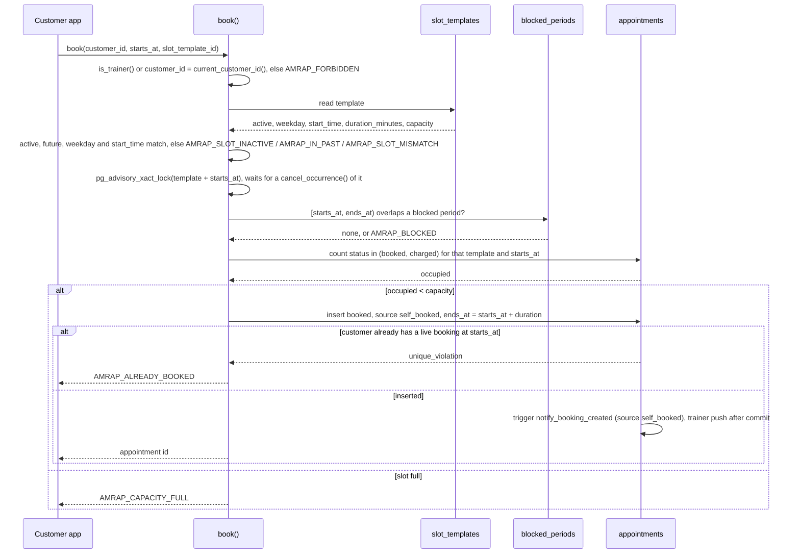

# Booking sequence

How a customer books an open slot. `book(p_customer_id, p_starts_at, p_slot_template_id)` is a
`SECURITY DEFINER` RPC that runs in one transaction: it checks the caller books for themselves,
validates the template (active, start in the future, on the template's weekday and start time
in `settings.timezone`), takes a transaction-scoped advisory lock on the slot occurrence so
concurrent bookings, materialization and `cancel_occurrence()` are serialized, rejects an
appointment whose `[starts_at, ends_at)` overlaps a blocked period (so one that starts before a
closure but runs into it is rejected too; checked after the lock, so a booking that waited on a
whole-session cancel sees the period it added), counts the
appointments occupying it (`booked` plus `charged`) against the template's capacity, and
inserts only if there is room (ADR 0004). The trainer goes through the same RPC without the
future check, and may also book ad hoc (no template, explicit end, no capacity). Every
rejection is an `AMRAP_*` error token, listed in [rpcs.md](../rpcs.md#book). A customer's own
booking fires the trigger that notifies the trainer (best effort, never fails the booking;
[notifications.md](../notifications.md#event-notifications)).

