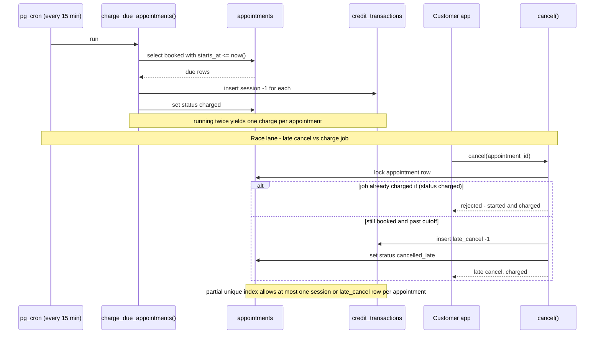

# Charging sequence

How a credit is deducted. The first lane is the normal path: pg_cron calls
`charge_due_appointments()` every 15 minutes, which writes one `session` transaction per due
appointment. The second lane is the race: a customer late-cancel arrives at the same time as the
job. `cancel` locks the appointment row, so exactly one of the two writes the charge, and the
partial unique index on `credit_transactions` (ADR 0003) is the final guard.

