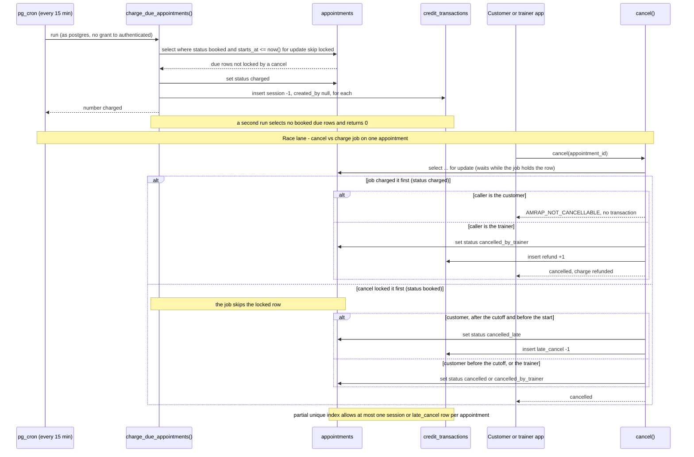

# Charging sequence

How a credit is deducted. The first lane is the normal path: pg_cron calls
`charge_due_appointments()` every 15 minutes (job `charge_due_appointments`, see
[jobs.md](../jobs.md#schedules)), which locks every due
`booked` row with `for update skip locked`, sets it `charged` and writes one `session`
transaction per appointment, returning the count. The second lane is the race: a `cancel()`
arrives at the same time as the job. `cancel` locks the appointment row with `for update`
before reading its status, so the two are serialized: whichever holds the lock first decides,
and the other either skips the row (job) or sees the new status (cancel). The partial unique
index on `credit_transactions` (ADR 0003) is the final guard.

