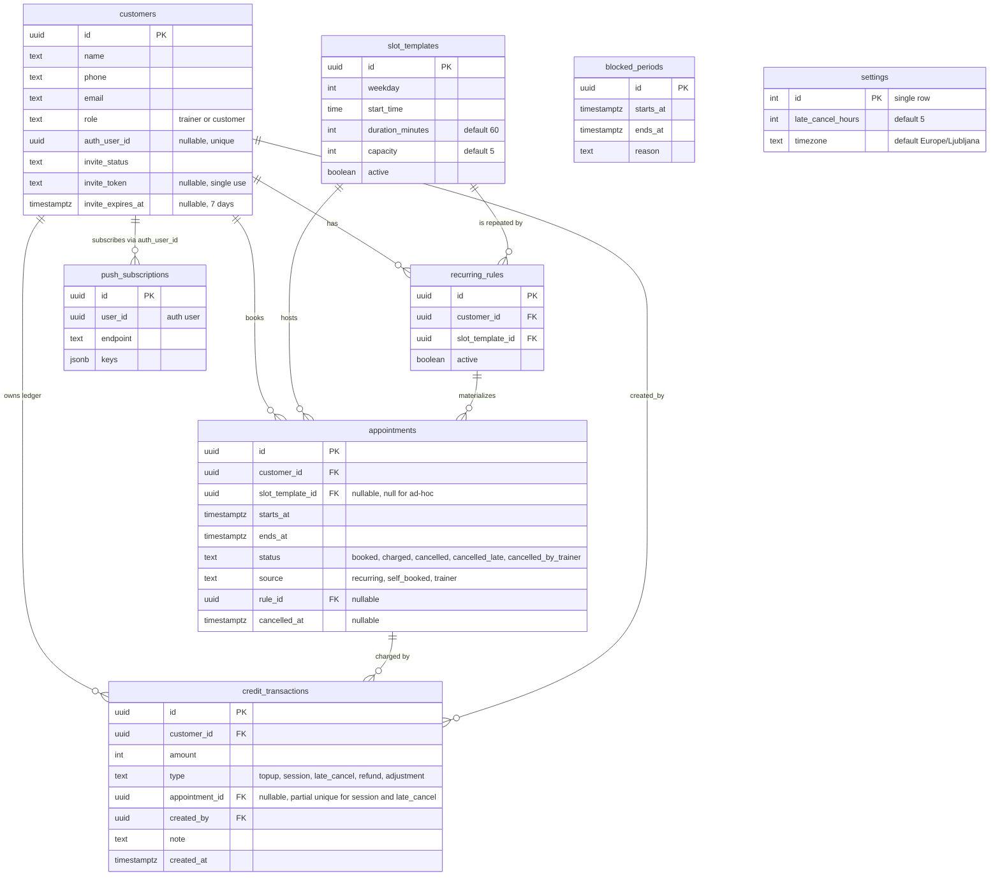

# Data model

Entity-relationship diagram of every table. The model is ledger-first: there is no balance
column; a customer's balance is `SUM(credit_transactions.amount)`, exposed by the view
`customer_balances` (ADR 0003). All tables are under RLS and all credit and capacity changes go
through RPCs. Column lists show the main fields; the migration is the exact definition and
`docs/schema.md` is the reference.

