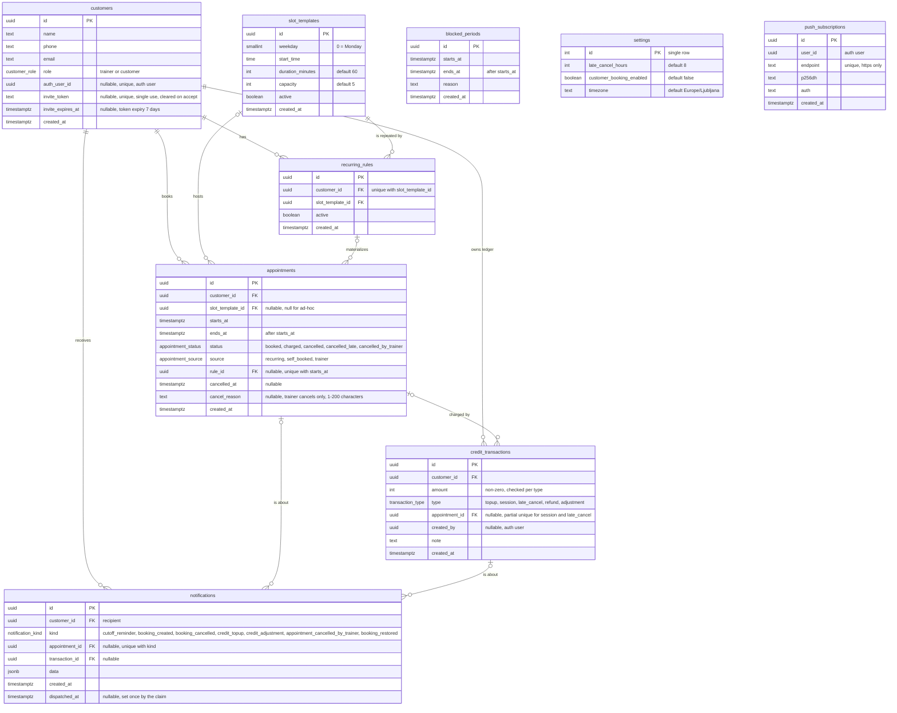

# Data model

Entity-relationship diagram of every table. The model is ledger-first: there is no balance
column; a customer's balance is `SUM(credit_transactions.amount)`, exposed by the view
`customer_balances` (ADR 0003). Invite status is not stored; it is derived: linked when
`auth_user_id` is not null, pending when `invite_token` is not null and `invite_expires_at > now()`,
otherwise none. `push_subscriptions.user_id` and `credit_transactions.created_by` reference
`auth.users` (not drawn), so they reach a customer only indirectly through
`customers.auth_user_id`. A recurring rule materializes at most one appointment per start
(unique `appointments(rule_id, starts_at)` where `rule_id` is set, any status). The view
`slot_occupancy` (not drawn) counts `booked` and `charged` appointments per slot template and
`starts_at` for linked callers; it runs as its owner and exposes counts only, never customer
identities. `notifications` is the push log (ADR 0009): one row per push the database decided to
send, unique per `(kind, appointment_id)`, closed to the API. All tables are under RLS and all credit and capacity changes go
through RPCs. Column lists show the main fields; the migration is the exact definition and
`docs/schema.md` is the reference.

