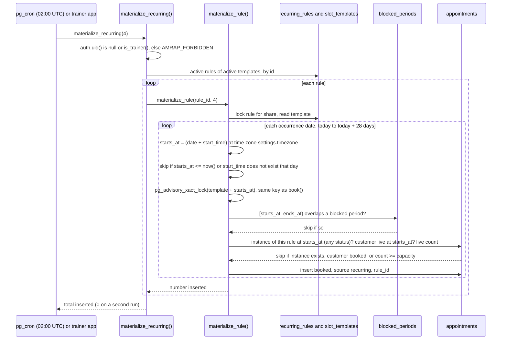

# Materialization sequence

How recurring rules become appointments. `materialize_recurring()` runs nightly from pg_cron
(as `postgres`, no signed-in user) or when the trainer calls it, and runs the private helper
`materialize_rule()` for every active rule of an active slot template; `activate_rule()` runs
the same helper for one rule. For each occurrence date from today through four weeks ahead
(local dates in `settings.timezone`), the helper builds `starts_at` from the date and the
template's `start_time` in the gym's timezone (DST-safe), skips past starts and starts that do
not exist that day, then takes the same advisory lock as `book()` and skips the occurrence if it
overlaps a blocked period (checked after the lock, so a concurrent `cancel_occurrence()` is
seen), if the rule already has an instance there (any
status, so a cancelled one is never recreated), if the customer is already booked at that
start, or if the slot is full. Otherwise it inserts a `booked` appointment with
`source = 'recurring'`. A second run inserts nothing. Details in
[rpcs.md](../rpcs.md#materialize_recurring).

