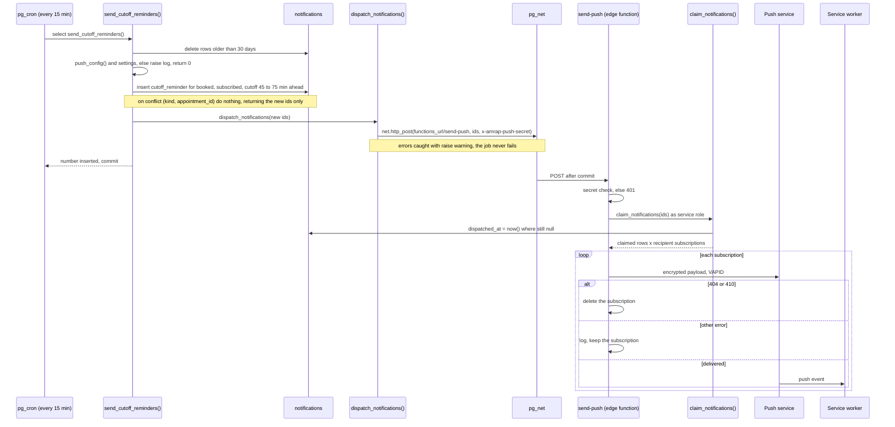

# Push sequence

How a notification travels from the database to a device (ADR 0009). A writer (here the
15-minute reminder job) records `notifications` rows with a unique `(kind, appointment_id)`
key and dispatches only the ids its insert returned, so re-runs and overlapping runs push
nothing new. `dispatch_notifications()` queues one pg_net request, which leaves only after the
writer's transaction commits, and never raises. The `send-push` edge function checks the shared
secret, claims the ids once with `claim_notifications()` (at most once per notification), and
sends to each of the recipient's subscriptions; a 404 or 410 from the push service deletes that
subscription. Without the Vault config the writer logs and records nothing. Details in
[notifications.md](../notifications.md).

