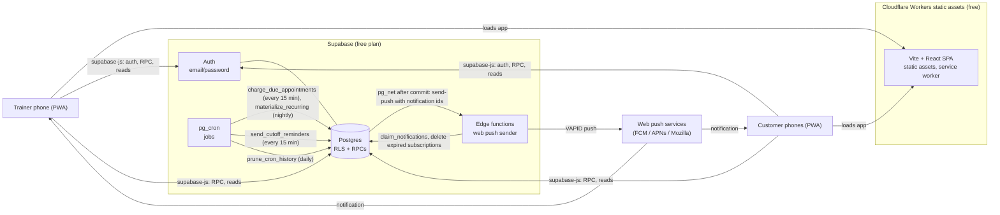

# System context

AMRAP is a single-page PWA served by an assets-only Cloudflare Worker and used on the trainer's
and the customers' phones. All data, authentication and scheduled work live in one Supabase
project on the free plan: Postgres with RLS and `SECURITY DEFINER` RPCs, Supabase Auth, pg_cron
for the recurring jobs and edge functions that send web push through the browser vendors' push
services. See ADR 0005 for the stack choice, ADR 0012 for the hosting and ADR 0009 for push:
Postgres records each notification and calls the `send-push` edge function through pg_net.

